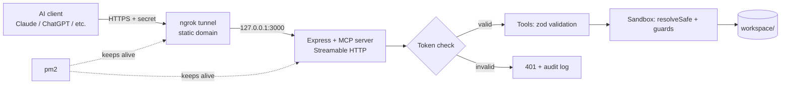

# MCP File-Server Connector: Project Documentation

**Course / project:** CSE2 Midterm Project, MCP file-server connector
**Student:** _(your name)_
**Repository:** _(paste your GitHub link)_
**Status:** M1 to M4 built. M5 (multi-session proof, report, demo) in progress.

> **Security note:** this document never contains the real token, the ngrok authtoken, or a working connector URL. Placeholders such as `YOUR-DOMAIN` and `YOUR_TOKEN` are used on purpose.

---

## 1. What this project is

An **MCP (Model Context Protocol) server** that lets an AI app (Claude, ChatGPT and others) create and manage files on my own computer from a plain-English prompt.

Example: *"Create a file called notes.txt with this content"* becomes a `write_file` tool call, and the file appears in a folder on my PC. Word documents (`.docx`) work through a dedicated tool.

The server is also built as **shared memory for agents**: handoff files let a new AI session pick up exactly where the last one stopped.

**Why the server runs on my PC:** the AI lives in the cloud and cannot touch my hard drive. A small local server does the file work, and the AI only sends it instructions.

---

## 2. Architecture



### Repository layout (separated responsibilities)

```
mcp-file-server/
├── src/
│   ├── server/index.ts        # HTTP endpoint, tool registration, server instructions
│   ├── config/config.ts       # all settings, read from environment variables
│   ├── security/
│   │   ├── sandbox.ts         # resolveSafe(): the single gate every path passes through
│   │   ├── guards.ts          # append-only logs, protected folders
│   │   ├── auth.ts            # token check (timing-safe)
│   │   └── audit.ts           # audit log of every call
│   └── tools/                 # one file per tool, plus helpers.ts and gitRun.ts
├── tests/                     # sandbox and guard tests
├── docs/                      # this file and screenshot evidence
├── ecosystem.config.cjs       # pm2 config (server + tunnel)
├── .env.example               # settings template (real .env is git-ignored)
├── tsconfig.json / tsconfig.build.json
└── workspace/                 # the ONLY folder the AI can touch (git-ignored)
```

### Architecture improvements (requested by the professor)

| Improvement | What it does |
|---|---|
| Separated folders (`server`, `tools`, `config`, `security`) | Each part has one job and can be explained and tested alone |
| One file per tool | Single-purpose tools are easy to describe, review and test |
| One security gate (`resolveSafe`) | Every tool passes through the same check, so there is no way to forget it |
| Secrets in environment variables | No secrets in code or in the repository |
| Fails closed | The server refuses to start without a valid token |
| Compiled build run by pm2 | The server runs plain JavaScript from `dist/`, not TypeScript directly |
| Audit log | Every call is recorded (tool and path, never file contents) |
| Helpful `isError` messages | Errors are short and actionable, never raw stack traces |
| Server instructions | New AI sessions are told the protocol automatically |

---

## 3. Tech stack and why

| Layer | Choice | Why this choice | Alternative considered |
|---|---|---|---|
| Runtime and SDK | Node.js + official TypeScript MCP SDK (v1) | Official SDK, best documented, TypeScript catches mistakes early. Pinned to v1 so a future major release cannot break it | Python + FastMCP |
| Transport | Streamable HTTP, stateless mode | Remote AI clients connect over HTTP. Stateless means each request is independent, so a restart loses nothing | stdio (local only, cannot be reached by cloud clients) |
| Validation | `zod` schemas on every tool input | Bad input is rejected before it touches any file | `pydantic` (Python) |
| Exposure | ngrok with a free static domain | Gives a public HTTPS address without router or firewall changes. The domain stays the same after restarts | Cloudflare Tunnel, or a small VPS |
| Process manager | pm2 | Restarts the server and tunnel after a crash. Works on Windows | systemd or Docker |
| Version control | git on the host | Project history, and also the engine for the git-lite tools | Any git CLI setup |
| Testing | `node:test` for the sandbox, MCP Inspector, then a real client | Automated attack tests plus manual proof with real tools | Scripted JSON-RPC calls |

---

## 4. The 13 tools

| # | Tool | Purpose | Safety features |
|---|---|---|---|
| 1 | `list_files` | List one folder (not recursive) | Path through sandbox |
| 2 | `read_file` | Read a text file in chunks | Max 20,000 characters per call, 5 MB file cap, tells the agent the next offset |
| 3 | `write_file` | Create a text file (`.txt`, `.md`, `.json`, `.csv`, code) | Fails if the file exists unless `overwrite=true`, 1,000,000 character limit, blocked on append-only logs |
| 4 | `str_replace` | Edit one exact piece of text | Text must match exactly once, blocked on append-only logs |
| 5 | `delete_file` | Move a file or folder to `.trash/` | Needs `confirm=true`, recoverable, root and `handoff/` cannot be deleted |
| 6 | `create_folder` | Create a folder and missing parents | Path through sandbox |
| 7 | `search_files` | Case-insensitive search of names and contents | Max 50 results, skips binaries, big files, symlinks and `.trash` |
| 8 | `write_docx` | Create a real Word document | `.docx` only, max 500 paragraphs, no overwrite by default |
| 9 | `init_handoff` | Create the four handoff files | Never overwrites, safe to call every session |
| 10 | `append_handoff` | Add a timestamped entry to a log | Append-only, fixed file list, 2,000 character entries, 200 KB log cap |
| 11 | `git_status` | Show changes in the workspace repo | Read-only |
| 12 | `git_commit` | Save all workspace changes as one commit | No shell, hooks skipped, author "MCP Agent" |
| 13 | `git_log` | Show recent commits | Read-only, max 50 |

---

## 5. Security design

### Threats and defenses

| Threat | Defense |
|---|---|
| AI reads or writes files outside the workspace (`../../secret`, `C:\Windows\...`) | `resolveSafe()` resolves every path against `workspace/` and rejects escapes |
| A shortcut (symlink) inside the workspace points elsewhere | The real path of the nearest existing parent is checked with `realpath` |
| Git hooks used to run code | `.git` folders are blocked for all file tools. Git commits skip hooks (`--no-verify`) |
| Windows path tricks (`GIT~1`, `file.txt:stream`, trailing dots) | Names containing `~digit`, `:` or a trailing dot or space are rejected |
| Strangers use the public URL | Secret token required. Missing or wrong token returns 401 and is logged |
| Token guessing by timing | Both values are hashed (SHA-256) and compared with `timingSafeEqual` |
| Server reachable from the local network | Binds to `127.0.0.1` only. The tunnel is the only way in |
| Accidental open server | Server refuses to start if `MCP_TOKEN` is missing or shorter than 32 characters |
| Agent destroys another agent's work | Logs are append-only, deletes go to `.trash/`, overwriting needs `overwrite=true` |
| Runaway writes | Size limits on writes, replacements, docx content, log entries and request bodies (2 MB) |
| Command injection through git | Git runs with `execFile` and an argument list, never a shell string |
| Leaking details in errors | Errors use `isError` with short messages, no stack traces |

### Known tradeoffs (honest limits)

- **The secret is in the URL path.** The Claude custom-connector form has no field for custom headers (and a custom header name needs Anthropic approval), so the URL carries the secret. URLs can appear in logs of ngrok and of the AI provider. The server also accepts `Authorization: Bearer ...` for clients that support headers. **Mitigation:** the token is long and random (32 random bytes), and can be rotated by editing `.env` and running `pm2 restart mcp-file-server`.
- **Anyone holding the URL has full access to the workspace.** The workspace is a dedicated folder, so nothing else on the PC is reachable, but files inside it are not private from the AI.
- **Symlink checks have a small timing gap** between check and use. Only a local user could exploit it, and the workspace is not shared.
- **No rate limiting.** The free ngrok plan has monthly request and bandwidth limits that act as a rough cap.
- **`.trash/` is not emptied automatically.** Recovery is possible, but the folder grows until cleaned by hand.
- **Tested on Windows only.**

---

## 6. Handoff protocol (shared memory for agents)

Files live in `workspace/handoff/`:

| File | Role | How it changes |
|---|---|---|
| `PROJECT_STATE.md` | Where the project stands right now and next steps | Edited with `str_replace` |
| `PLAN_LOG.md` | Plans, and changes of plan | Append-only (`append_handoff`) |
| `CHECKPOINTS.md` | What is finished and verified at the end of a session | Append-only |
| `DECISIONS.md` | Each decision and the reason | Append-only |

**Session routine** (also sent to every client as server instructions):

1. Call `init_handoff` (safe), then read `PROJECT_STATE.md` and the latest log entries.
2. Append a short plan to `PLAN_LOG` before acting.
3. Search before reading, read in chunks, batch independent calls, never retry a failed call with the same input.
4. At the end: update `PROJECT_STATE.md`, append a `CHECKPOINT`, run `git_commit`.

The protocol is enforced by the server, not just suggested: the three logs cannot be overwritten, edited or deleted by any tool.

---

## 7. Setup guide (reproduce from scratch)

**Prerequisites:** Windows, Node.js LTS, Git, a free ngrok account.

```powershell
git clone YOUR_REPO_LINK
cd mcp-file-server
npm install
```

**1. Create `.env`** (copy `.env.example`). Generate the token with:

```powershell
node -p "require('node:crypto').randomBytes(32).toString('hex')"
```

```
PORT=3000
HOST=127.0.0.1
MCP_TOKEN=your-generated-token
# Optional: WORKSPACE_ROOT=C:\Users\YourName\Documents\AI-Workspace
```

**2. Build**

```powershell
npm run build
npm test
```

**3. ngrok.** Download the standalone Windows ZIP from ngrok.com into `C:\ngrok` (the Microsoft Store version cannot be launched by pm2). Then:

```powershell
C:\ngrok\ngrok.exe config add-authtoken YOUR_NGROK_AUTHTOKEN
```

Claim your free static domain in the ngrok dashboard (Domains page).

**4. Edit `ecosystem.config.cjs`:** set `YOUR-DOMAIN.ngrok-free.dev` in the ngrok `args` line.

**5. Start with pm2**

```powershell
npm install -g pm2
pm2 start ecosystem.config.cjs
pm2 status          # both apps should be online
pm2 save
npm install -g pm2-windows-startup
pm2-startup install # start at login
```

**6. Check the lock**

```powershell
curl.exe -i -X POST https://YOUR-DOMAIN.ngrok-free.dev/mcp -H "Content-Type: application/json" -d "{}"
# expected: 401 Unauthorized
```

**7. Connect a client.** In Claude: Settings, Connectors, Add custom connector, URL `https://YOUR-DOMAIN.ngrok-free.dev/mcp/YOUR_TOKEN`. Other clients that support headers can send `Authorization: Bearer YOUR_TOKEN` to `/mcp`.

**After any code change:**

```powershell
npm run build
pm2 restart mcp-file-server
```

---

## 8. Build log by milestone

### M1: Skeleton
- **Built:** project and Git repo, TypeScript setup, Express endpoint at `/mcp`, one tool (`list_files`).
- **Why:** prove the toolchain works before adding anything complex.
- **Verified:** MCP Inspector showed `list_files` returning a test file.
- **Evidence:** `docs/m1-inspector.png`, first commit.

### M2: Sandbox
- **Built:** `resolveSafe()`, audit log, `isError` helpers, 8 tools (`list_files`, `read_file`, `write_file`, `str_replace`, `delete_file`, `create_folder`, `search_files`, `write_docx`).
- **Why:** once tools accept paths, an AI could ask for any file on the PC. The sandbox is the main security feature.
- **Verified:** path-escape tests (`npm test`, `fail 0`), Inspector run of every tool, a `../package.json` read returned "Access denied", and `report.docx` opened in Word.
- **Evidence:** `docs/m2-tests.png`, `docs/m2-denied.png`.

### M3: Deploy
- **Built:** token authentication, bind to `127.0.0.1`, `.env` configuration, compiled build, ngrok static-domain tunnel, pm2 process management.
- **Why:** cloud AI clients need a public HTTPS address, and a public address needs a lock and a process manager that restarts crashes.
- **Verified:** 401 without the token (local and public), pm2 shows both apps online, killing the server process makes pm2 restart it, a real client connected.
- **Evidence:** `docs/m3-pm2.png`, `docs/m3-auth-public.png`, `docs/m3-restart.png`, `docs/m3-reboot.png`, `docs/m3-client.png`.

### M4: Protocol
- **Built:** handoff tools (`init_handoff`, `append_handoff`), git-lite tools (`git_status`, `git_commit`, `git_log`), append-only guards, `.git` and Windows-alias blocking, size limits, server instructions. Total 13 tools.
- **Why:** shared memory lets a new session continue where the last one stopped, git records agent changes, and guards stop one agent from damaging another's work.
- **Verified:** guard tests, plus Inspector checks that overwriting `PLAN_LOG.md`, touching `.git` and deleting `handoff/` are all blocked.
- **Evidence:** `docs/m4-tests.png`, `docs/m4-tools.png`, `docs/m4-guards.png`, `docs/m4-git.png`, `docs/m4-handoff.png`.

### M5: Prove it _(to complete)_
- **Planned task:** a multi-step task run across 2 or more agent sessions, using the handoff files to carry context.
- **To record here:** the task, the transcript, how many calls each session used, what was read from `PROJECT_STATE.md` at the start of session 2, and the final `CHECKPOINTS` entry.
- **Also due:** the short report (stack, tool design, security tradeoffs) and the 5-minute demo script.

---

## 9. Problems met and how they were solved

| Problem | Cause | Fix |
|---|---|---|
| `git add .` failed with "does not have a commit checked out" | A second Git repo had been created inside another one | Worked in the inner project folder and kept one repo for the project |
| Inspector v2 did not show a Connect button | Newer Inspector layout | Added the server by URL and used the toggle on the server card |
| `list_files` returned "workspace is empty" | The test file was in a different folder than the server's workspace | Checked the `Workspace root:` line the server prints and used that folder |
| Red underlines on `node:test` imports | `tests/` was not included in `tsconfig.json` | Set `include` to `["src", "tests"]` and `types` to `["node"]` |
| `npm run dev` exited immediately with no message | `src/server/index.ts` lost its `app.listen` section during an edit | Replaced the whole file |
| `npx rsc --noEmit` failed | Typo: the TypeScript checker is `tsc` | Used `npx tsc --noEmit` |
| `npm run build` could not find `tsconfig.build.json` | File had not been created | Created it in the project root |
| pm2: "Script not found ... WindowsApps\ngrok.exe" | The Microsoft Store ngrok is a shortcut that pm2 cannot launch, and the path was also pasted into the server entry by mistake | Used the standalone `C:\ngrok\ngrok.exe` and corrected both `script:` lines |
| ngrok restarted over and over under pm2 | The standalone copy had no authtoken and was outdated | Ran `ngrok update` and `config add-authtoken`, then `pm2 reset all` |
| Project lives inside OneDrive | OneDrive syncs thousands of `node_modules` files | Kept an eye on file-lock errors, and `node_modules` is excluded from Git |

---

## 10. Testing

### Automated: `npm test`

- **Sandbox tests:** allowed paths (normal, nested, `..` that stays inside) and rejected attacks (`../secret.txt`, `../../etc/passwd`, `..\..\Windows\win.ini`, absolute paths, null byte, `.git/config`, `.GIT/hooks/pre-commit`, `GIT~1/config`, `notes.txt:hidden`, and others).
- **Guard tests:** append-only logs protected (also in a different letter case), `PROJECT_STATE.md` and normal files stay editable, critical folders cannot be deleted.

### Manual: MCP Inspector

| Tool | Input | Expected result |
|---|---|---|
| `write_file` | `notes.txt` | File created |
| `write_file` | same again | Error: already exists |
| `read_file` | `../package.json` | **Access denied** |
| `delete_file` | no `confirm` | Error: needs `confirm=true` |
| `delete_file` | `confirm=true` | Moved to `.trash/` |
| `write_file` | `handoff/PLAN_LOG.md` with overwrite | **Blocked**: append-only |
| `read_file` | `.git/config` | **Access denied** |
| `git_commit` then `git_log` | any message | Commit hash, then one log line |

### Endpoint check

| Request | Expected |
|---|---|
| No token (local or public URL) | `401 Unauthorized` |
| Correct token | Anything except 401 |

---

## 11. Efficiency design (Rubric A)

- `read_file` returns chunks and says where the next chunk starts, so agents don't load whole files.
- `search_files` finds the right file and line before any read.
- Server instructions tell agents to plan first, batch independent calls, and never retry a failed call with the same input.
- Output is capped on every tool (50 search results, 20,000 characters per read, 50 log lines).
- Error messages say what to do next (for example "Use list_files to see what exists"), which avoids blind retries.

---

## 12. Evidence checklist

| Rubric item | Evidence | Done |
|---|---|---|
| A. Agent efficiency | Tool-call transcript, `PLAN_LOG.md` | [ ] |
| B. Agent and tool management | Handoff files, `logs/audit.log`, config | [ ] |
| C. Tool design | Source in `src/tools/`, Inspector run (`docs/m4-tools.png`) | [ ] |
| D. Tech stack | Section 3 of this file, repo layout, `.env.example`, survives restart (`docs/m3-reboot.png`) | [ ] |
| E. Security | Tests (`docs/m2-tests.png`, `docs/m4-tests.png`), denied screenshots, 401 checks | [ ] |
| F. Docs and demo | README, this file, meaningful `git log`, live demo | [ ] |

**Submission package:**

- [ ] Repository link and README
- [ ] Transcript of one multi-step task across 2 or more sessions
- [ ] `PLAN_LOG` and `CHECKPOINTS` files
- [ ] This documentation with screenshots in `docs/`
- [ ] Short report (stack, tool design choices, security tradeoffs)
- [ ] 5-minute live demo script

---

## 13. Possible future improvements

- Per-agent tokens, so the audit log can say which agent made each call
- Rate limiting and automatic emptying of `.trash/`
- More document tools (`.xlsx`, `.pdf`)
- OAuth instead of a secret in the URL
- A Cloudflare Tunnel or small VPS option for higher limits
